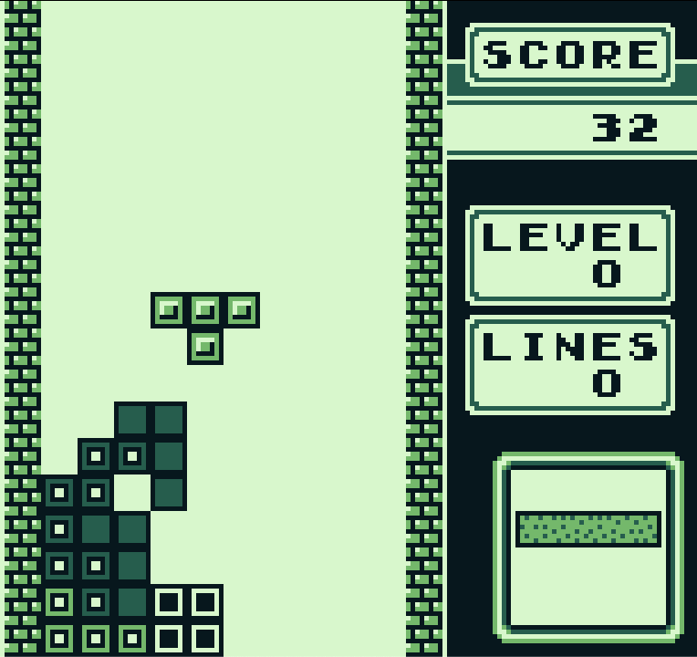
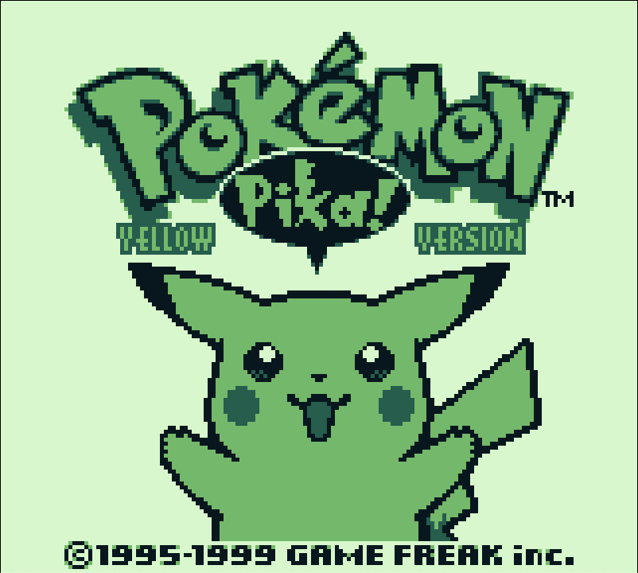
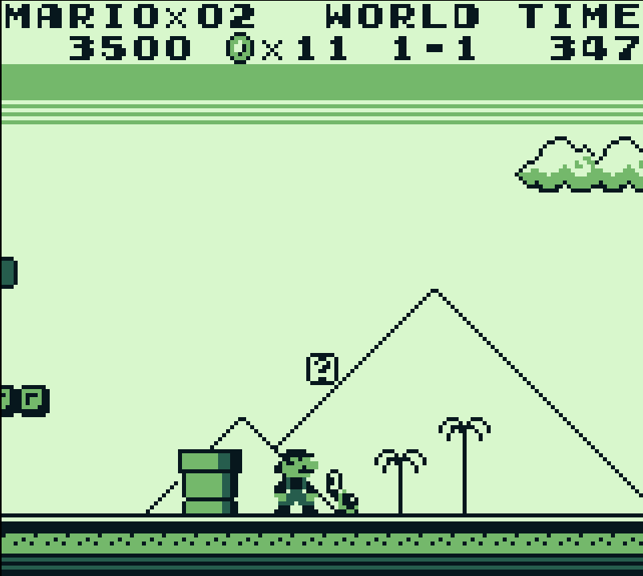

This project is an attempt to use AI to develop a Game Boy Classic (DMG) emulator from end to end, using natural-language-driven implementation and review. There are likely bugs, but I was able to play several titles without issue.

Current scope includes:
- Workspace split into `gb-core`, `gb-headless`, and `gb-desktop`.
- Deterministic core emulation with CPU, memory bus, timers, interrupts, PPU, APU, DMA, joypad, serial, cartridge mappers, save import/export, and snapshots.
- Headless runner for scripted, repeatable execution and JSON reporting (including frame/audio hashes).
- Desktop frontend with windowed rendering, input mapping, and audio output pipeline.
- Strict quality gates with formatting, clippy, and full test coverage in CI-style commands.

# Development Approach

The process used to build this repository was:

1. Generate and lock Rust engineering standards.
2. Create a high-level emulator architecture design.
3. Break implementation into phase-based low-level design documents (LLDs).
4. Have the AI validate and refine design consistency.
5. Implement phase by phase in small slices with tests.
6. Open new context windows when model context became saturated.
7. Iterate on compatibility, opcode completeness, video quality, and audio behavior.

In practice, this meant repeatedly combining:
- explicit standards,
- architecture and LLD documentation,
- deterministic tests,
- focused prompts with narrow scope.

The workflow of standards -> high-level design -> phased LLDs -> iterative implementation proved very effective.

## Examples

Tetris:



Pokemon Yellow:



Super Mario Land:



# Context Window Strategy

When context usage approaches roughly 70%, I start a fresh agent session and hand off using the design documents plus a focused prompt. This keeps implementation quality and instruction-following stable.

# How to Run

## Prerequisites

- Rust toolchain (stable) with `cargo`.
- A local `.gb` ROM file.

## Build

```bash
cargo build
```

## Run Desktop Frontend

```bash
cargo run -p gb-desktop -- --rom "/absolute/path/to/rom.gb"
```

Optional flags:

- `--boot-rom <path>`
- `--save-in <path>`
- `--save-out <path>`
- `--max-cycles <n>`
- `--mute`
- `--audio-diagnostics`
- `--video-diagnostics`

Example:

```bash
cargo run -p gb-desktop --release -- --rom "/absolute/path/to/rom.gb"
```

## Run Headless

Run for a frame budget:

```bash
cargo run -p gb-headless -- --rom "/absolute/path/to/rom.gb" --frames 600
```

Run for a cycle budget:

```bash
cargo run -p gb-headless -- --rom "/absolute/path/to/rom.gb" --cycles 1000000
```

Compatibility tier runner:

```bash
cargo run -p gb-headless -- --compat-tier smoke
```

Optional flags for single runs:

- `--boot-rom <path>`
- `--input-script <path>`
- `--save-in <path>`
- `--save-out <path>`

## Validation Commands

```bash
cargo fmt
cargo clippy --all-targets --all-features -- -D warnings -D clippy::all -D clippy::pedantic
cargo test --all-targets --all-features
```

## Future TODOs

- Audio fidelity is improved but still not fully complete; additional DMG-accuracy tuning is planned.
- Perform thourough tests of all additional run commands.
